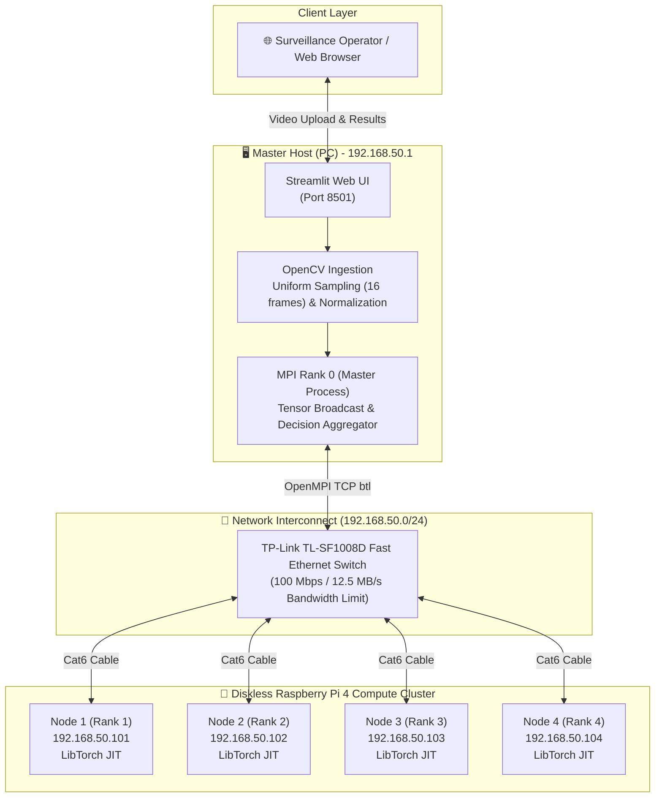
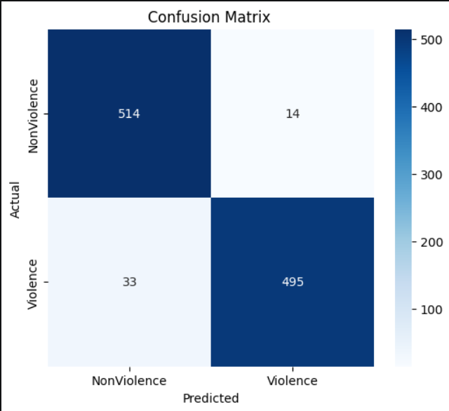

# Low-Cost HPC Cluster using MPI for Real-Time Violence Detection

[](https://www.python.org/)
[](https://pytorch.org/)
[](https://www.open-mpi.org/)
[](https://violence-detection-model.streamlit.app/)
[](LICENSE)

An academic High-Performance Computing (HPC) and Deep Learning project that implements an end-to-end distributed video violence detection system on a heterogeneous cluster consisting of a host workstation (Master PC) and four diskless **Raspberry Pi 4 Model B** compute nodes interconnected via OpenMPI.

---

## 1. Project Introduction

Automated surveillance requires real-time video stream classification without relying on costly multi-GPU enterprise infrastructure. This project explores the feasibility, scalability, and performance boundaries of deploying a deep spatio-temporal action recognition model across an affordable, heterogeneous Beowulf-style single-board computer cluster.

### Academic Context
- **Academic Year**: 2025–2026 (2CS / Master's Program)
- **Institution**: [National Higher School of Computer Science (ESI), Sidi Bel Abbès, Algeria](https://www.esi-sba.dz/)
- **Project Role**: **Group Leader** (Leading cluster architecture design, deep learning pipeline integration, evaluation, and documentation)
- **Supervisors**: Dr. Abdelkader AMRANE & Dr. Abdelatif RAHMOUN
- **Team Members**: El Baraa BELAID (Group Leader), Mohamed BOUCHEMELLA, Mohamed Sghir TOUATI TLIBA, Haithem BLIZAK, Mohamed Amine BENGHERABI

### Core Technologies
- **Parallel & Distributed Computing**: OpenMPI 4.1.6, C++ LibTorch API, `mpi4py`, POSIX Sockets
- **Cluster Infrastructure**: Diskless PXE Netboot, NFSv3 Root Sharing, `dnsmasq` (DHCP/TFTP), Ed25519 Passwordless SSH, Linux Kernel NAT Masquerading
- **Deep Learning**: PyTorch, TorchVision (3D ResNet-18 Backbone), Transformer Encoders, Temporal Pooling
- **Demonstration & UI**: Streamlit, OpenCV

---

## 2. Key Features

- **Heterogeneous Distributed Inference**: Orchestrates workload distribution across an x86_64 host and 4 ARM64 Raspberry Pi compute nodes via OpenMPI.
- **Diskless Cluster Provisioning**: Nodes boot over the network using PXE, TFTP, and NFS from a single golden base image, completely eliminating SD card degradation and simplifying cluster scaling.
- **Hybrid 3D-CNN + Transformer Architecture**: Fuses pre-trained 3D ResNet-18 spatial-temporal feature extraction with a multi-head self-attention Transformer encoder for long-range action reasoning.
- **Empirically Tuned Thresholding**: Replaces standard 0.5 decision boundaries with an optimized 0.65 threshold, achieving **97.25% Precision** and **95.55% Test Accuracy** to eliminate costly false alarms.
- **Interactive Web Demonstration**: A Streamlit interface supporting video file uploads, live probability meters, and decision alerts.
- **Rigorous Scalability & Overhead Analysis**: Evaluated against classical parallel models (**Amdahl's Law**, **Gustafson's Law**, and the **Karp-Flatt metric**) with quantified network saturation profiling.

---

## 3. System Architecture

### 3.1 Application & Data Flow Architecture



### 3.2 Infrastructure & Network Boot Layer

```mermaid
flowchart LR
    subgraph BootServices ["Master Host Services (192.168.50.1)"]
        Dnsmasq["dnsmasq<br/>(DHCP + TFTP)"]
        NFS["nfs-kernel-server<br/>/srv/nfs/slave*"]
        NAT["iptables NAT<br/>Internet Gateway"]
    end

    subgraph Network ["100Mbps Ethernet Switch"]
        SwitchNode["Switch Fabric"]
    end

    subgraph PiNodes ["Raspberry Pi 4 Nodes (Diskless)"]
        PiA["Pi Node 1<br/>192.168.50.101"]
        PiB["Pi Node 2<br/>192.168.50.102"]
        PiC["Pi Node 3<br/>192.168.50.103"]
        PiD["Pi Node 4<br/>192.168.50.104"]
    end

    Dnsmasq -->|1. DHCP Lease & TFTP Kernel| SwitchNode
    NFS -->|2. Mount Root Filesystem (NFSv3)| SwitchNode
    NAT -->|3. Route External Traffic| SwitchNode
    SwitchNode --> PiA
    SwitchNode --> PiB
    SwitchNode --> PiC
    SwitchNode --> PiD
```

---

## 4. Hardware & Software Requirements

| Category | Component | Description / Specification |
|---|---|---|
| **Master Node** | Workstation PC | x86_64 architecture, 16 GB DDR4 RAM, Dual Ethernet NICs (Uplink + Cluster NIC) |
| **Worker Nodes** | 4x Raspberry Pi 4B | Quad-core ARM Cortex-A72 @ 1.5 GHz, 4GB/8GB LPDDR4-3200 per node (Diskless) |
| **Interconnect** | Switch & Cabling | TP-Link TL-SF1008D 8-Port 10/100 Mbps switch, Cat6 UTP Ethernet cabling |
| **Operating System**| Linux Environments | Host: Ubuntu / Debian x86_64; Workers: Raspberry Pi OS 64-bit (Debian 12 Bookworm) |
| **MPI Runtime** | OpenMPI 4.1.6 | Configured with TCP byte-transfer layer (`--mca btl_tcp_if_include 192.168.50.0/24`) |
| **Frameworks** | PyTorch / LibTorch | PyTorch $\ge 2.0$, TorchVision $\ge 0.15$, OpenCV $\ge 4.8$, Streamlit $\ge 1.28$ |

### Requirement Categories
- **Single-Machine Demonstration**: Only requires Python 3.10+, PyTorch, and Streamlit. Can run on standard laptop/desktop CPUs without GPU or cluster hardware.
- **Full Distributed Cluster**: Requires physical Raspberry Pi nodes, an Ethernet switch, OpenMPI, and network boot services.

---

## 5. Installation & Quick Start

### 5.1 Local Demonstration (Single Machine)

1. **Clone the repository:**
   ```bash
   git clone https://github.com/Baraebld/hpc-cluster-violence-detection.git
   cd hpc-cluster-violence-detection
   ```

2. **Create and activate a virtual environment:**
   ```bash
   python3 -m venv venv
   source venv/bin/activate  # On Windows: .\venv\Scripts\Activate.ps1
   ```

3. **Install dependencies:**
   ```bash
   pip install -r requirements.txt
   ```

4. **Verify / Download model weights:**
   ```bash
   python scripts/download_model.py
   ```
   *The checkpoint `hybrid_model3.pth` (~162.7 MB) is automatically fetched from [Hugging Face Spaces](https://huggingface.co/spaces/Baraebld/Violence-Detection-model/tree/main/models).*

5. **Run unit tests:**
   ```bash
   python -m pytest tests/
   ```

6. **Launch the Streamlit web app:**
   ```bash
   streamlit run app/app.py
   ```
   Access the web interface at `http://localhost:8501`.

---

### 5.2 Distributed Cluster Execution (OpenMPI)

1. **Ensure network and passwordless SSH are active:**
   ```bash
   sudo ./scripts/setup_network.sh
   ./scripts/setup_ssh_keys.sh
   ```

2. **Compile the MPI benchmarks & LibTorch engine:**
   ```bash
   cd mpi
   make benchmarks
   ```

3. **Run matrix multiplication benchmark (Table 1 reproduction):**
   ```bash
   mpirun -np 4 --host 192.168.50.101,192.168.50.102,192.168.50.103,192.168.50.104 \
       ./matmul_benchmark 2000
   ```

4. **Run distributed C++ LibTorch violence detection:**
   ```bash
   mpirun -np 5 --host 192.168.50.1,192.168.50.101,192.168.50.102,192.168.50.103,192.168.50.104 \
       ./violence_mpi_master ../models/hybrid_model3.pt ../data/sample_video.mp4 0.65
   ```

---

## 6. MPI Master–Worker Implementation

The C++ OpenMPI implementation ([`mpi/violence_mpi_master.cpp`](mpi/violence_mpi_master.cpp)) uses LibTorch and OpenCV:

1. **Video Ingestion & Uniform Sampling (Master)**:
   Master Rank 0 decodes the video using OpenCV and uniformly extracts 16 frames across duration:
   $$\text{indices} = \text{round}\left(i \times \frac{\text{total\_frames} - 1}{15}\right), \quad i \in [0, 15]$$
   Frames are converted to RGB, resized to $224 \times 224$, and normalized with ImageNet statistics:
   $$\mathbf{x}_{\text{norm}} = \frac{\frac{\text{pixel}}{255.0} - \boldsymbol{\mu}_{\text{ImageNet}}}{\boldsymbol{\sigma}_{\text{ImageNet}}}$$

2. **Why Broadcast the Full 16-Frame Tensor?**
   > *The model was trained on 16-frame temporal sequences. Splitting videos into disjoint 4-frame sub-clips destroys learned temporal motion trajectories and velocity vectors. Broadcasting the full tensor to all Raspberry Pis enables independent inference; combining worker outputs suppresses random noise while ensuring immediate alert triggers if any worker exceeds the detection threshold.*

3. **Custom MPI Tensor Protocol**:
   Transfers multi-dimensional contiguous float buffers across ranks:
   - `TAG_TENSOR_NDIM (10)`: Number of dimensions (5)
   - `TAG_TENSOR_SHAPE (11)`: Tensor dimensions `[1, 16, 3, 224, 224]`
   - `TAG_TENSOR_DATA (12)`: Contiguous float32 raw buffer
   - `TAG_RESULT_PROB (20)` & `TAG_RESULT_UNC (21)`: Worker probability and uncertainty results

4. **Inference & Decision Aggregation**:
   Each worker runs `model.forward({input})` in TorchScript with `torch::NoGradGuard`. Master receives all predictions, computes average and maximum probabilities, and triggers a violence alert if `max_prob > 0.65`.

---

## 7. Deep Learning Model

```text
Input Video [Batch, 16, 3, 224, 224]
  │
  ▼
3D ResNet-18 Backbone (Pretrained on Kinetics-400)
  ├── Layers 1–3: Frozen (Preserves generalized spatio-temporal features)
  └── Layer 4: Fine-Tuned (Adapts to rapid physical movement)
  │
  ▼ Spatio-Temporal Embeddings [Batch, 16, 512]
Transformer Temporal Encoder
  ├── 3 Layers, 8 Attention Heads, d_model = 512
  └── Multi-head self-attention across frame sequence
  │
  ▼ Attention-Based Temporal Pooling
Dual Prediction Heads
  ├── Classification Head ──> Raw Logit ──> Sigmoid ──> Violence Probability
  └── Uncertainty Head    ──> Variance Metric      ──> Prediction Confidence
```

### Training Highlights
- **Dataset**: ~7,000 merged video clips (RLVS, Hockey Fights, Video Violence Detection Dataset).
- **Split**: 70% Train, 15% Validation, 15% Test (**1,050 holdout test samples**).
- **Loss**: Focal Loss with Label Smoothing ($\epsilon=0.1$) to prioritize hard edge-case physical collisions.
- **Regularization**: MixUp, uniform temporal jitter, speed variation ($0.8\times$–$1.2\times$), Cosine Annealing learning rate schedule, gradient clipping ($1.0$).
- **Optimal Decision Threshold**: **0.65** (balances precision at 97.25% with recall at 93.75%).

---

## 8. Experimental Results

> [!NOTE]
> Deep learning classification metrics and distributed cluster execution metrics measure different aspects of the system. Classification metrics evaluate model quality; speedup and efficiency measure parallel hardware scaling.

### 8.1 Model Classification Performance (1,050 Test Samples)

| Evaluation Metric | Measured Value | Operational Significance |
|---|---|---|
| **Test Accuracy** | **95.55%** | Reliable discrimination across diverse environments |
| **Precision** | **97.25%** | Minimizes false positive alarms in active security monitoring |
| **Recall** | **93.75%** | Effectively detects critical violent events |
| **F1-Score** | **95.47%** | Optimal harmonic balance between Precision and Recall |
| **ROC-AUC** | **0.9746** | High class separability |
| **Decision Threshold** | **0.65** | Empirically selected operating point |

<p align="center">
  
  <br>
  <em>Figure 1: Confusion matrix evaluated on 1,050 independent test video samples.</em>
</p>

---

### 8.2 HPC Cluster Benchmark Performance (Matrix Multiplication, $N=2000$, 4.8 GB Data)

| Cluster Configuration | Total Time (s) | Compute Time (s) | Communication Overhead (s) | Speedup $S(p)$ | Parallel Efficiency $E(p)$ |
|---|---|---|---|---|---|
| **Sequential (PC)** | **1042.7** | 1042.7 | 0.0 | $1.000\times$ | $100.0\%$ |
| **1-Pi Worker (MPI)** | **2354.3** | 2148.7 | 205.7 | $0.443\times$ | $44.3\%$ |
| **4-Pi Workers (MPI)** | **844.1** | 519.6 | 324.5 | **$1.235\times$** | **$30.9\%$** |

### 8.3 Parallel Scalability & Overhead Analysis
- **Per-Worker Load Balance**: Compute times across the four nodes were **Pi 1: 501.8s**, **Pi 2: 502.2s**, **Pi 3: 495.7s**, and **Pi 4: 519.6s**, yielding a minimal load imbalance of **2.9%**. This confirms the workload is evenly divided and the bottleneck is not algorithmic skew.
- **Network Bandwidth Saturation**: Transferring 4,800 MB across the 100 Mbps switch took **324.5s** (theoretical wire limit is $384.0\text{s}$), indicating that the network operated at **84.5% of wire capacity**.
- **Amdahl's Law Analysis**: Serial fraction $f_s = 0.3845$ (38.45% communication serialization), establishing a theoretical speedup ceiling of $S_{\max} = \frac{1}{f_s} = \mathbf{2.601\times}$.
- **Karp-Flatt Metric**: The experimental serial fraction was $e = \mathbf{74.6\%}$, reflecting that system-level network contention and master transfer serialization amplified the theoretical limits.

---

### 8.4 Proposed Hardware Upgrade (Theoretical Projection)

> [!WARNING]
> The figures below are **theoretical projections** modeling an upgraded Gigabit network fabric, not empirical measurements.

The existing setup routes native Gigabit-capable Raspberry Pi 4 nodes through a 100 Mbps Fast Ethernet switch. Replacing the switch with a **TP-Link TL-SG108 Gigabit Switch** ($\approx \$20\text{ USD}$) yields:

| Metric | 100 Mbps Switch (Measured) | 1 Gbps Switch (Theoretical Projection) | Performance Delta |
|---|---|---|---|
| **Communication Time** | 324.5 s | 38.4 s | **$-88.2\%$** |
| **Total Execution Time** | 844.1 s | 558.0 s | **$-33.9\%$** |
| **Speedup $S(4)$** | **$1.235\times$** | **$1.870\times$** | **$+51.4\%$** |
| **Serial Fraction $f_s$** | 38.45% | 6.88% | $-31.57\%$ |
| **Amdahl Speedup Ceiling $S_{\max}$**| $2.601\times$ | $14.53\times$ | $+458.6\%$ |
| **Parallel Efficiency $E(4)$** | 30.9% | 46.7% | $+15.8\%$ |

---

## 9. Limitations & Future Work

### Evidence-Supported Limitations
1. **Network Bandwidth Bottleneck**: The 100 Mbps switch accounts for 38.4% of total runtime, constraining parallel efficiency to 30.9%.
2. **Heterogeneous Compute Disparity**: The x86_64 desktop master computes significantly faster per-core than the ARM Cortex-A72 nodes, requiring carefully balanced master-worker roles.
3. **Serial Master Dispatch**: The master sends tensors to workers sequentially, introducing serialization delays before concurrent inference begins.

### Future Work
- **Gigabit Network Upgrade**: Install an unmanaged Gigabit switch to realize the projected $1.87\times$ speedup.
- **Non-blocking Asynchronous MPI**: Replace blocking `MPI_Send` loops with `MPI_Ibcast` or asynchronous ring communication.
- **Edge Acceleration**: Integrate Google Coral USB accelerators or Hailo-8 AI modules on worker nodes for quantized edge inference.
- **RTSP Live Stream Integration**: Connect the Master pipeline directly to live IP security cameras via RTSP/WebRTC.

---

## 10. Repository Structure

```text
hpc-cluster-violence-detection/
├── README.md                   # Comprehensive project overview & technical documentation
├── LICENSE                     # MIT Open-Source License
├── .gitignore                  # Git hygiene rules (excludes heavy checkpoints & virtual envs)
├── requirements.txt            # Python dependencies (PyTorch, OpenCV, Streamlit, etc.)
├── environment.yml             # Conda environment definition
├── app/
│   ├── app.py                  # Interactive Streamlit demonstration application
│   └── __init__.py
├── configs/
│   ├── config.py               # Centralized configuration (paths, frame size, sampling rates)
│   └── __init__.py
├── models/
│   ├── model.py                # HybridVideoClassifier (3D ResNet-18 + Transformer definition)
│   ├── README.md               # Checkpoint download guide and architecture metadata
│   └── __init__.py
├── src/
│   ├── load_model.py           # Model loading, device auto-detection, and state verification
│   ├── video_utils.py          # OpenCV frame extraction, uniform sampling & ImageNet normalization
│   └── __init__.py
├── mpi/
│   ├── violence_mpi_master.cpp # C++ LibTorch + OpenMPI Master & Worker inference engine
│   ├── distributed_inference.py# Python mpi4py distributed video processing alternative
│   ├── matmul_benchmark.c      # Distributed matrix multiplication benchmark (Table 1)
│   ├── mpi_trap_pi.c           # Numerical integration MPI benchmark
│   ├── hello_mpi.c             # Cluster connectivity verification test
│   └── Makefile                # Build configuration for C/C++ MPI binaries
├── scripts/
│   ├── provision_node.sh       # Diskless Raspberry Pi netboot auto-provisioning script
│   ├── setup_network.sh        # NAT masquerading & IP forwarding gateway setup
│   ├── setup_ssh_keys.sh       # Automated Ed25519 passwordless SSH cluster setup
│   └── download_model.py       # Automated model checkpoint downloader
├── docs/
│   ├── architecture.md         # Detailed hardware, network, and dataflow specifications
│   ├── infrastructure.md       # PXE bootloader, TFTP, NFS golden image & dnsmasq setup
│   ├── mpi_implementation.md   # MPI tensor protocol and Master-Worker implementation
│   ├── deep_learning_model.md  # Model architecture, training strategy & thresholding
│   ├── experiments.md          # Full benchmarks, Amdahl/Gustafson/Karp-Flatt models & upgrade
│   ├── installation.md         # Step-by-step reproduction guide (Local vs. Cluster)
│   └── hpc_cluster_final_report.pdf # Complete 37-page academic report
├── tests/
│   ├── conftest.py             # Pytest fixtures and environment configuration
│   ├── test_model_loading.py   # Unit tests for model loading and device detection
│   ├── test_video_utils.py     # Unit tests for OpenCV video frame sampling
│   └── __init__.py
├── notebooks/                  # Exploratory data preparation and training notebooks
└── assets/                     # Original figures, confusion matrix, loss curves, and screenshots
```

---

## 11. Academic Report, Acknowledgments & References

### Full Report
The complete 37-page academic report is included in this repository:  
📄 **[docs/hpc_cluster_final_report.pdf](docs/hpc_cluster_final_report.pdf)**

### Supervision & Acknowledgments
This academic project was developed at the **National Higher School of Computer Science (ESI), Sidi Bel Abbès, Algeria** under the supervision of:
- **Dr. Abdelkader AMRANE**
- **Dr. Abdelatif RAHMOUN**

Special recognition to all members of the student project group:
- **El Baraa BELAID** (Group Leader)
- **Mohamed BOUCHEMELLA**
- **Mohamed Sghir TOUATI TLIBA**
- **Haithem BLIZAK**
- **Mohamed Amine BENGHERABI**

### Datasets & References
1. **RLVS Dataset**: B. B. Soutif et al., *Real-Life Violence Situations Dataset for Video Classification*.
2. **Hockey Fight Dataset**: E. Bermejo et al., *Violence Detection in Video using Computer Vision and Deep Learning Techniques*.
3. **R3D-18 Backbone**: Tran et al., *A Closer Look at Spatiotemporal Convolutions for Action Recognition*, CVPR 2018.
4. **Attention Is All You Need**: Vaswani et al., NeurIPS 2017.
5. **OpenMPI**: Gabriel et al., *Open MPI: Goals, Concept, and Design of a Next Generation MPI Implementation*, EuroPVM/MPI 2004.
