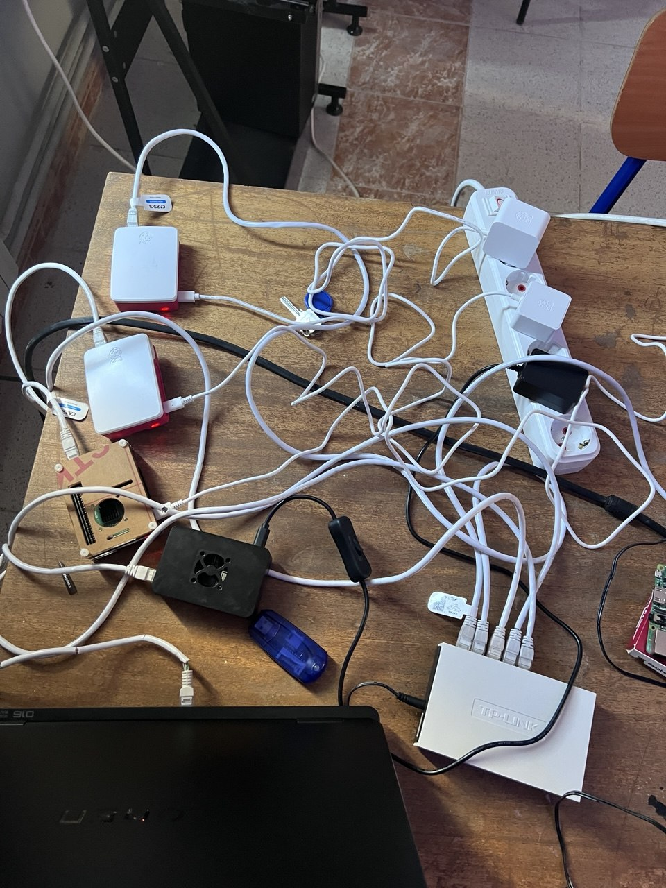
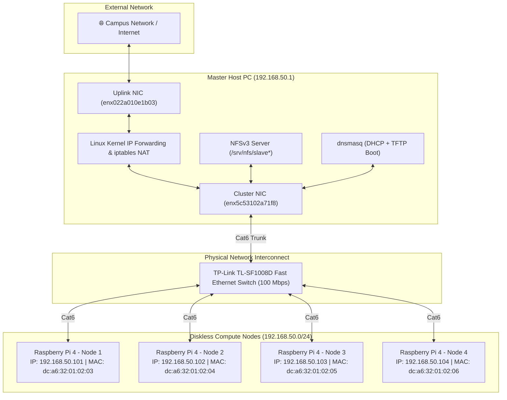
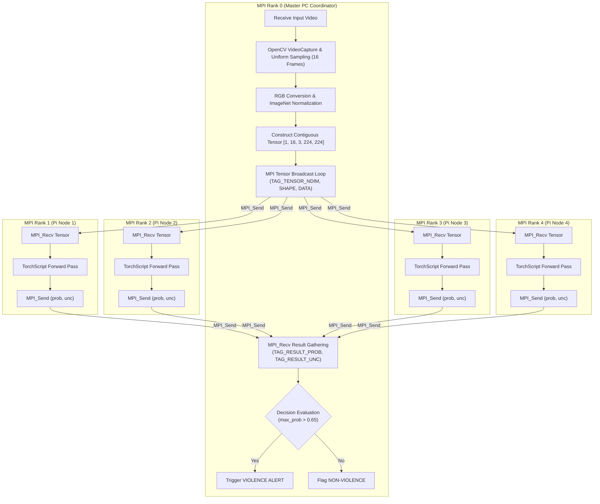
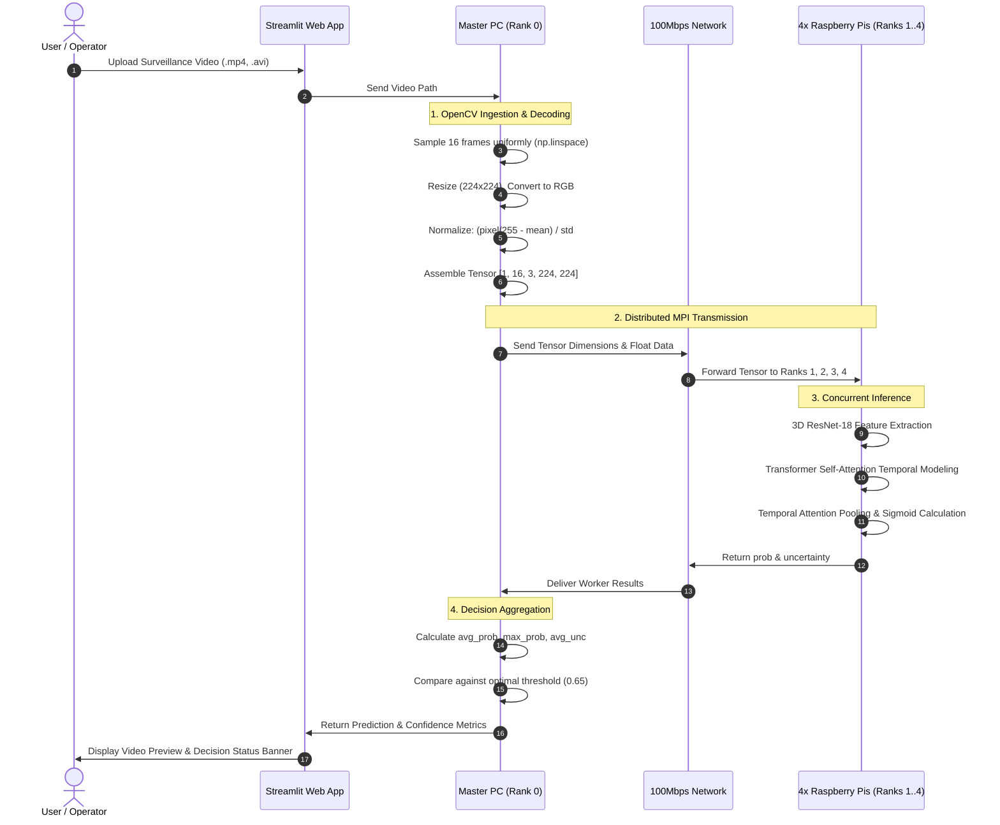

# Low-Cost HPC Cluster using MPI for Real-Time Violence Detection

[](https://www.python.org/)
[](https://pytorch.org/)
[](https://www.open-mpi.org/)
[](https://violence-detection-model.streamlit.app/)
[](LICENSE)

An academic High-Performance Computing (HPC) and Deep Learning project that implements an end-to-end distributed video violence detection system on a heterogeneous cluster consisting of a host workstation (Master PC) and four diskless **Raspberry Pi 4 Model B** compute nodes interconnected via OpenMPI.

---

## 1. Project Overview & Objectives

Automated video surveillance requires continuous, low-latency processing of video streams to detect violent physical interactions in public spaces, transit hubs, and commercial facilities. While enterprise security systems rely on expensive GPU servers, this project explores the feasibility, scalability, and physical performance boundaries of a **low-cost, energy-efficient High-Performance Computing (HPC) cluster** built with off-the-shelf single-board computers (SBCs).

### Core Objectives
1. **Heterogeneous Distributed Computing**: Offload deep learning tensor workloads from a central controller to an array of low-cost compute nodes via OpenMPI.
2. **Diskless Cluster Infrastructure**: Eliminate SD card wear and maintenance overhead using a Preboot Execution Environment (PXE), TFTP, and Network File System (NFS) golden image auto-provisioning.
3. **High-Accuracy Spatio-Temporal Modeling**: Implement and train a hybrid 3D-CNN (ResNet-18) + Transformer encoder architecture capable of modeling complex human motion trajectories.
4. **Rigorous Scalability Evaluation**: Benchmark cluster speedup and parallel efficiency against classical theoretical models (**Amdahl's Law**, **Gustafson's Law**, and the **Karp-Flatt metric**) while identifying network bottlenecks.
5. **Interactive Demonstration**: Deliver an accessible web-based demonstration via Streamlit for model evaluation and live decision analysis.

### Academic Context
- **Academic Year**: 2025–2026 (2CS / Master's Program)
- **Institution**: [National Higher School of Computer Science (ESI), Sidi Bel Abbès, Algeria](https://www.esi-sba.dz/)
- **Project Role**: **Group Leader** (Coordinated cluster architecture design, deep learning pipeline integration, evaluation, and repository engineering)
- **Supervisors**: Dr. Abdelkader AMRANE & Dr. Abdelatif RAHMOUN
- **Team Members**: El Baraa BELAID (Group Leader), Mohamed BOUCHEMELLA, Mohamed Sghir TOUATI TLIBA, Haithem BLIZAK, Mohamed Amine BENGHERABI

---

## 2. Problem Statement & Motivation

### The Challenge
Video-based violence detection poses unique computational challenges:
- **Spatial Complexity**: Each individual frame contains background clutter, varying lighting, and diverse human postures.
- **Temporal Dynamics**: Violence is inherently temporal; isolated frames (such as a high-five or a hug) can easily trigger false alarms without analyzing consecutive motion velocity and acceleration patterns over time.
- **Computational Cost**: 3D convolutions and multi-head self-attention mechanisms demand significant memory bandwidth and compute cycles.
- **Economic Constraints**: Edge environments (schools, small businesses, local municipalities) often lack the budget and power infrastructure to deploy power-hungry multi-GPU servers.

### The Proposed Solution
By pairing an x86_64 workstation with a cluster of four diskless **Raspberry Pi 4 Model B** single-board computers interconnected over a private subnet, we distribute inference across multiple nodes. The master handles video decoding, uniform frame extraction, and decision aggregation, while compute nodes concurrently run optimized TorchScript JIT inference.

---

## 3. Physical HPC Cluster

The system was physically assembled, wired, and evaluated on bare-metal hardware.

<p align="center">
  
  <br>
  <em>Figure 1: Physical HPC cluster used for the project, showing the four-node Raspberry Pi 4 stack, active cooling fans, Cat6 Ethernet patch cables, and the Fast Ethernet switch.</em>
</p>

### Hardware Specifications

| Node / Component | Hardware Details | Role in Cluster |
|---|---|---|
| **Master Node (PC)** | Multi-core x86_64 CPU, 16 GB DDR4 RAM, Dual Ethernet NICs | Cluster Gateway, NFS Server, DHCP/TFTP Server, MPI Rank 0 (Coordinator) |
| **Worker Nodes (4x)** | Raspberry Pi 4 Model B (Quad-core ARM Cortex-A72 @ 1.5 GHz, 4GB/8GB LPDDR4) | Diskless Compute Nodes, MPI Ranks 1–4 (LibTorch JIT Inference) |
| **Network Switch** | TP-Link TL-SF1008D 8-Port 10/100 Mbps Fast Ethernet Switch | Cluster Interconnect ($12.5\text{ MB/s}$ throughput limit) |
| **Cabling** | Category 6 (Cat6) UTP Ethernet cables | Low-latency local network interconnect |
| **Power Distribution** | Multi-port 5V / 3A USB-C Power Supply | Dedicated power delivery per Raspberry Pi node |

---

## 4. System & Software Architecture

### 4.1 Physical Cluster Topology



### 4.2 Master/Worker MPI Architecture



### 4.3 Video-Processing & Inference Pipeline



---

## 5. Deep Learning Model Architecture

```text
Input Video Tensor: [Batch, 16, 3, 224, 224]
  │
  ▼
3D ResNet-18 Backbone (Pretrained on Kinetics-400)
  ├── Conv1, Layer1, Layer2, Layer3: Frozen (Preserves generalized motion features)
  ├── Layer4: Fine-Tuned (Domain-adapted for violent physical interactions)
  └── Fully Connected Head: Replaced with nn.Identity()
  │
  ▼ Spatio-Temporal Feature Sequence: [Batch, 16, 512]
Transformer Temporal Encoder
  ├── 3 Transformer Encoder Layers (d_model = 512, nhead = 8, batch_first = True)
  ├── Sinusoidal Positional Encoding (Preserves frame order and velocity)
  └── Multi-Head Self-Attention (Models action evolution across sequence)
  │
  ▼ Attention-Based Temporal Pooling
Dual Prediction Heads
  ├── Classification Head ──> nn.Linear(512, 1) ──> Sigmoid ──> Violence Probability
  └── Uncertainty Head    ──> nn.Linear(512, 1) ──> Variance Metric (Model Confidence)
```

### Preprocessing & Uniform Frame Sampling
Rather than ingesting every frame of a high-FPS video, the system extracts a fixed temporal window of **16 frames** evenly spaced across the clip's duration:
$$\text{indices} = \left\lfloor i \times \frac{\text{total\_frames} - 1}{15} \right\rceil, \quad i \in \{0, 1, \dots, 15\}$$
Frames are normalized with standard ImageNet statistics:
$$\mathbf{x}_{\text{norm}} = \frac{\frac{\mathbf{x}}{255.0} - \boldsymbol{\mu}_{\text{ImageNet}}}{\boldsymbol{\sigma}_{\text{ImageNet}}}$$

### Training Strategy & Decision Threshold
- **Loss Function**: Focal Loss combined with Label Smoothing ($\epsilon=0.1$) to counter class ambiguity and overconfidence.
- **Regularization**: MixUp data augmentation, temporal jittering, speed variation ($0.8\times$–$1.2\times$), Cosine Annealing learning rate schedule, gradient clipping ($1.0$).
- **Optimal Decision Threshold**: **0.65** (empirically selected on the validation set to balance precision at **97.25%** and recall at **93.75%**, reducing false alarms in automated security environments).

---

## 6. MPI Communication & Workload Distribution

### Why Broadcast Full 16-Frame Tensors?
> **Key Implementation Insight:**  
> Slicing a 16-frame clip into 4-frame sub-clips and scattering them across nodes destroys the temporal velocity and acceleration vectors learned by the 3D-CNN and Transformer.  
> 
> Therefore, in [`mpi/violence_mpi_master.cpp`](mpi/violence_mpi_master.cpp), the Master broadcasts the complete 16-frame tensor to all four Raspberry Pi nodes. Each worker executes independent inference on the identical sequence. Averaging probabilities suppresses sensor noise, while evaluating whether **any** single worker flags violence ($P > 0.65$) ensures high recall and responsiveness.

### Custom MPI Message Protocol
Because raw PyTorch tensors cannot be transmitted directly through MPI primitives without serialization, a custom protocol coordinates ranks:

| Message Tag | Identifier Macro | Data Type | Payload Contents |
|---|---|---|---|
| `10` | `TAG_TENSOR_NDIM` | `MPI_INT` | Number of tensor dimensions ($5$) |
| `11` | `TAG_TENSOR_SHAPE` | `MPI_LONG[]` | Dimensions array: `[1, 16, 3, 224, 224]` |
| `12` | `TAG_TENSOR_DATA` | `MPI_FLOAT[]` | Contiguous float32 raw pixel buffer |
| `20` | `TAG_RESULT_PROB` | `MPI_FLOAT` | Worker violence probability score $[0.0, 1.0]$ |
| `21` | `TAG_RESULT_UNC` | `MPI_FLOAT` | Worker model uncertainty score |
| `99` | `TAG_DONE` | `MPI_INT` | Cluster termination signal |

---

## 7. Experimental Results

> [!NOTE]
> Deep learning classification metrics and distributed execution benchmarks measure two different dimensions of the system: classification metrics evaluate prediction accuracy, while runtime speedup evaluates parallel hardware scaling.

### 7.1 Model Classification Performance (1,050 Holdout Test Samples)

| Evaluation Metric | Measured Value | Operational Meaning |
|---|---|---|
| **Test Accuracy** | **95.55%** | Correct classification rate across diverse surveillance scenarios |
| **Precision** | **97.25%** | High certainty when triggering a violent incident alert |
| **Recall** | **93.75%** | Sensitivity in identifying true violent encounters |
| **F1-Score** | **95.47%** | Harmonic mean balancing precision and sensitivity |
| **ROC-AUC** | **0.9746** | Strong discriminative ability across decision thresholds |
| **Optimal Threshold** | **0.65** | Tuned decision boundary minimizing false alarms |

<p align="center">
  
  <br>
  <em>Figure 2: Confusion matrix evaluated on the independent 1,050 test set video samples.</em>
</p>

---

### 7.2 HPC Cluster Benchmark Performance (Matrix Multiplication, $N=2000$, 4.8 GB Data)

| Cluster Configuration | Total Time (s) | Compute Time (s) | Communication Overhead (s) | Measured Speedup $S(p)$ | Parallel Efficiency $E(p)$ |
|---|---|---|---|---|---|
| **Sequential (PC)** | **1042.7** | 1042.7 | 0.0 | $1.000\times$ | $100.0\%$ |
| **1-Pi Worker (MPI)** | **2354.3** | 2148.7 | 205.7 | $0.443\times$ | $44.3\%$ |
| **4-Pi Workers (MPI)** | **844.1** | 519.6 | 324.5 | **$1.235\times$** | **$30.9\%$** |

### 7.3 Parallel Overhead & Scalability Analysis
- **Per-Worker Load Balance**: Individual compute times across the four nodes were **Pi 1: 501.8s**, **Pi 2: 502.2s**, **Pi 3: 495.7s**, and **Pi 4: 519.6s**. The measured load imbalance is only **2.9%**, confirming that the workload is evenly balanced and the performance bottleneck is not algorithmic skew.
- **Network Bandwidth Saturation**: Transferring 4,800 MB across the 100 Mbps switch took **324.5s** against a theoretical wire limit of $384.0\text{s}$, proving that the interconnect operated at **84.5% of wire capacity**.
- **Amdahl's Law Analysis**: With a measured serial communication fraction of $f_s = 0.3845$ (38.45%), Amdahl's Law establishes a theoretical four-worker speedup of $S_{\text{Amdahl}}(4) = 1.857\times$ and an asymptotic ceiling of $S_{\max} = \frac{1}{f_s} = \mathbf{2.601\times}$.
- **Karp-Flatt Metric**: The experimental serial fraction was $e = \mathbf{74.6\%}$, demonstrating how physical network contention and master sequential transmission amplified theoretical limits.

---

### 7.4 Proposed Hardware Upgrade (Theoretical Projection)

> [!WARNING]
> The figures below represent **theoretical projections** modeling an upgraded Gigabit network fabric, not empirical measurements.

The cluster connects native Gigabit-capable Raspberry Pi 4 nodes through a 100 Mbps Fast Ethernet switch. Replacing it with an unmanaged **TP-Link TL-SG108 Gigabit Switch** ($\approx \$20\text{ USD}$) yields:

| Metric | 100 Mbps Switch (Measured) | 1 Gbps Switch (Theoretical Projection) | Performance Delta |
|---|---|---|---|
| **Communication Overhead** | 324.5 s | 38.4 s | **$-88.2\%$** |
| **Total Execution Time** | 844.1 s | 558.0 s | **$-33.9\%$** |
| **Speedup $S(4)$** | **$1.235\times$** | **$1.870\times$** | **$+51.4\%$** |
| **Serial Fraction $f_s$** | 38.45% | 6.88% | $-31.57\%$ |
| **Amdahl Speedup Ceiling $S_{\max}$**| $2.601\times$ | $14.53\times$ | $+458.6\%$ |
| **Parallel Efficiency $E(4)$** | 30.9% | 46.7% | $+15.8\%$ |

---

## 8. Technologies & Tools

| Domain | Technology / Library | Role in Project |
|---|---|---|
| **Parallel Computing** | OpenMPI 4.1.6 | Distributed process management, TCP byte-transfer layer, inter-node communication |
| **Distributed Inference** | LibTorch C++ API / `mpi4py` | Native C++ TorchScript execution on ARM Cortex-A72 cores and Python MPI alternative |
| **Deep Learning** | PyTorch & TorchVision | Model training, 3D ResNet-18 feature extraction, Transformer self-attention |
| **Computer Vision** | OpenCV (`cv2`) | Video stream ingestion, uniform frame sampling, color conversion, resizing |
| **Web Interface** | Streamlit | Operator demonstration interface, video preview, threshold control |
| **Network Booting** | PXE, TFTP, NFSv3, `dnsmasq` | Diskless booting, central golden image sharing, DHCP management |
| **Cluster Security** | OpenSSH (Ed25519) | Passwordless authentication for remote process spawning by `orted` |
| **Routing & NAT** | Linux `iptables` | Master PC gateway routing internet access to isolated cluster subnet |

---

## 9. Repository Structure

```text
Low-Cost-HPC-Cluster-using-MPI-for-Real-Time-Violence-Detection/
├── README.md                   # Complete project presentation, architecture & benchmarks
├── LICENSE                     # MIT Open-Source License
├── .gitignore                  # Git hygiene rules (excludes heavy checkpoints, caches & envs)
├── requirements.txt            # Pinned Python dependencies
├── environment.yml             # Conda environment definition
├── app/
│   ├── app.py                  # Streamlit demonstration web interface
│   └── __init__.py
├── configs/
│   ├── config.py               # Preprocessing configurations, frame count (16), dimensions (224x224)
│   └── __init__.py
├── models/
│   ├── model.py                # HybridVideoClassifier (3D ResNet-18 + Transformer definition)
│   ├── README.md               # Checkpoint download instructions and architectural metadata
│   └── __init__.py
├── src/
│   ├── load_model.py           # Model loader with automatic device fallback (CUDA/MPS/CPU)
│   ├── video_utils.py          # OpenCV video ingestion, uniform sampling & ImageNet normalization
│   └── __init__.py
├── mpi/
│   ├── violence_mpi_master.cpp # C++ LibTorch + OpenMPI Master & Worker inference engine
│   ├── distributed_inference.py# Python mpi4py distributed video chunk processing
│   ├── matmul_benchmark.c      # Distributed matrix multiplication benchmark (Table 1)
│   ├── mpi_trap_pi.c           # Numerical integration MPI benchmark
│   ├── hello_mpi.c             # Cluster connectivity verification test
│   └── Makefile                # Build configuration for C/C++ MPI binaries
├── scripts/
│   ├── provision_node.sh       # Diskless Raspberry Pi netboot auto-provisioning script
│   ├── setup_network.sh        # NAT masquerading & IP forwarding gateway setup
│   ├── setup_ssh_keys.sh       # Automated Ed25519 passwordless SSH cluster setup
│   └── download_model.py       # Helper script to download trained weights from Hugging Face
├── docs/
│   ├── architecture.md         # Hardware specifications, network topology & dataflow diagrams
│   ├── infrastructure.md       # Diskless PXE netboot, TFTP, NFS golden image & dnsmasq setup
│   ├── mpi_implementation.md   # MPI tensor protocol and Master-Worker implementation
│   ├── deep_learning_model.md  # Model architecture, training strategy & threshold tuning
│   ├── experiments.md          # Full benchmarks, Amdahl/Gustafson/Karp-Flatt models & upgrade
│   ├── installation.md         # Step-by-step reproduction guide (Local vs. Cluster)
│   └── hpc_cluster_final_report.pdf # Complete 37-page academic report
├── tests/
│   ├── conftest.py             # Pytest fixtures and sample configurations
│   ├── test_model_loading.py   # Unit tests for model loading and device detection
│   ├── test_video_utils.py     # Unit tests for video frame sampling
│   └── __init__.py
├── notebooks/                  # Exploratory data preparation and training notebooks
└── assets/                     # Original figures, confusion matrix, loss curves, and screenshots
    ├── images/
    │   └── physical-cluster.jpg# Photograph of the bare-metal physical HPC cluster
    ├── cluster_hardware_stack.jpg
    ├── cluster_setup_photo.jpg
    ├── confusion_matrix.png
    ├── esi_sba_logo.png
    ├── streamlit_app_interface.png
    └── training_loss_accuracy_curve.png
```

---

## 10. Installation & Quick Start

### 10.1 Local Demonstration (Single Machine)
You do **not** need the physical Raspberry Pi cluster to test the model or run the demonstration interface.

1. **Clone the repository:**
   ```bash
   git clone https://github.com/Baraebld/Low-Cost-HPC-Cluster-using-MPI-for-Real-Time-Violence-Detection.git
   cd Low-Cost-HPC-Cluster-using-MPI-for-Real-Time-Violence-Detection
   ```

2. **Create and activate a virtual environment:**
   ```bash
   python3 -m venv venv
   source venv/bin/activate  # On Windows: .\venv\Scripts\Activate.ps1
   ```

3. **Install dependencies:**
   ```bash
   pip install -r requirements.txt
   ```

4. **Obtain the trained model weights:**
   ```bash
   python scripts/download_model.py
   ```
   *The model checkpoint `hybrid_model3.pth` (~162.7 MB) is automatically downloaded from [Hugging Face Spaces](https://huggingface.co/spaces/Baraebld/Violence-Detection-model/tree/main/models) into `models/`.*

5. **Run unit tests:**
   ```bash
   python -m pytest tests/
   ```

6. **Launch the Streamlit web application:**
   ```bash
   streamlit run app/app.py
   ```
   Open `http://localhost:8501` in your browser.

---

### 10.2 Distributed Cluster Execution (Requires Physical Cluster)

> [!IMPORTANT]
> The commands below require bare-metal access to the 5-node cluster (1 Master PC + 4 Raspberry Pi nodes) on subnet `192.168.50.0/24` with OpenMPI installed.

1. **Configure Master Network & SSH:**
   ```bash
   sudo ./scripts/setup_network.sh
   ./scripts/setup_ssh_keys.sh
   ```

2. **Compile the MPI benchmarks & LibTorch engine:**
   ```bash
   cd mpi
   make benchmarks
   ```

3. **Execute 4-Node Matrix Multiplication Benchmark:**
   ```bash
   mpirun -np 4 --host 192.168.50.101,192.168.50.102,192.168.50.103,192.168.50.104 \
       ./matmul_benchmark 2000
   ```

4. **Execute Distributed C++ LibTorch Inference:**
   ```bash
   mpirun -np 5 --host 192.168.50.1,192.168.50.101,192.168.50.102,192.168.50.103,192.168.50.104 \
       ./violence_mpi_master ../models/hybrid_model3.pt ../data/surveillance_sample.mp4 0.65
   ```

---

## 11. Limitations & Future Work

### Documented Limitations
- **Interconnect Bandwidth Bottleneck**: The 100 Mbps switch ($12.5\text{ MB/s}$) accounts for 38.4% of total runtime, constraining parallel efficiency to 30.9%.
- **Master Dispatch Serialization**: The Master broadcasts tensors sequentially across ranks via blocking `MPI_Send`, causing worker idle time.
- **Heterogeneous Compute Disparity**: The x86_64 host computes substantially faster than the ARM Cortex-A72 cores, requiring careful master-worker workload separation.

### Proposed Future Improvements
- **Gigabit Network Fabric**: Deploying an unmanaged Gigabit switch to achieve the projected $1.87\times$ speedup.
- **Asynchronous Non-blocking MPI**: Refactoring transmission loops with `MPI_Ibcast` or asynchronous double-buffered ring topologies.
- **Hardware Edge Accelerators**: Integrating Google Coral Edge TPUs or Hailo-8 AI modules on worker nodes for accelerated int8 inference.
- **Live Video Streaming**: Ingesting real-time video streams directly from IP surveillance cameras via RTSP/WebRTC.

---

## 12. Academic Report, Acknowledgments & References

### Academic Report
The complete 37-page academic report is available in the repository:  
📄 **[docs/hpc_cluster_final_report.pdf](docs/hpc_cluster_final_report.pdf)**

### Supervision & Acknowledgments
Developed at the **National Higher School of Computer Science (ESI), Sidi Bel Abbès, Algeria** under the supervision of:
- **Dr. Abdelkader AMRANE**
- **Dr. Abdelatif RAHMOUN**

Student Project Team:
- **El Baraa BELAID** (Group Leader)
- **Mohamed BOUCHEMELLA**
- **Mohamed Sghir TOUATI TLIBA**
- **Haithem BLIZAK**
- **Mohamed Amine BENGHERABI**

### Datasets & Key References
1. **RLVS Dataset**: B. B. Soutif et al., *Real-Life Violence Situations Dataset for Video Classification*.
2. **Hockey Fight Dataset**: E. Bermejo et al., *Violence Detection in Video using Computer Vision and Deep Learning Techniques*.
3. **3D ResNet (R3D-18)**: D. Tran et al., *A Closer Look at Spatiotemporal Convolutions for Action Recognition*, CVPR 2018.
4. **Transformer Architecture**: A. Vaswani et al., *Attention Is All You Need*, NeurIPS 2017.
5. **OpenMPI**: E. Gabriel et al., *Open MPI: Goals, Concept, and Design of a Next Generation MPI Implementation*, EuroPVM/MPI 2004.
