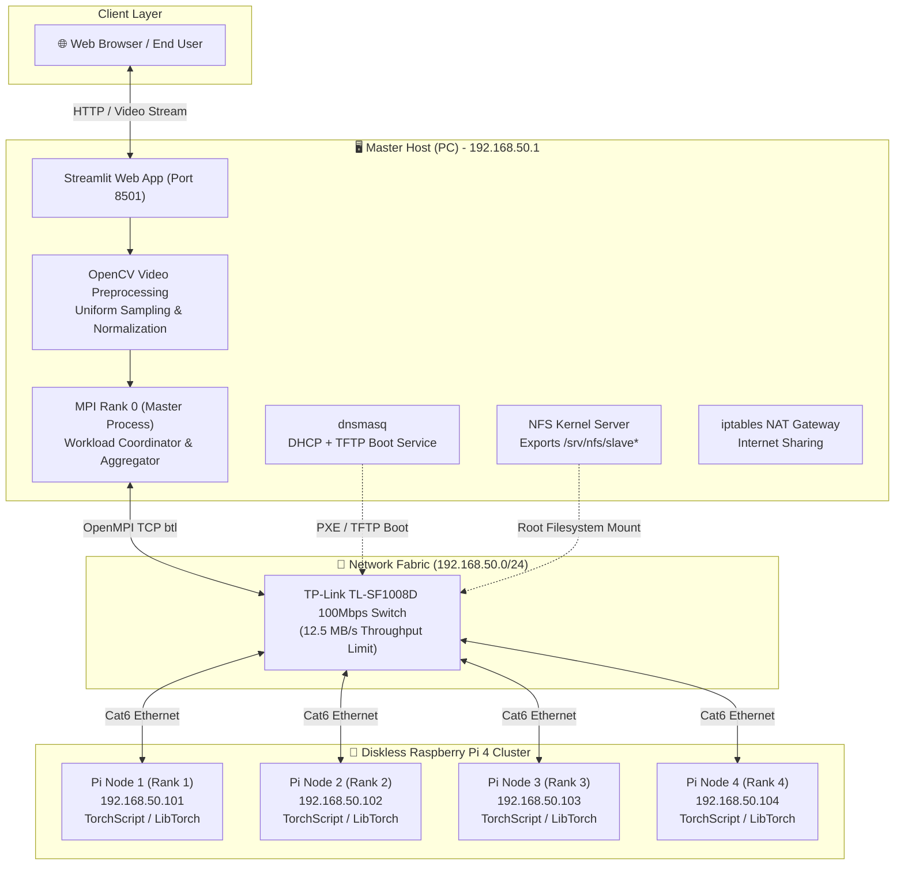
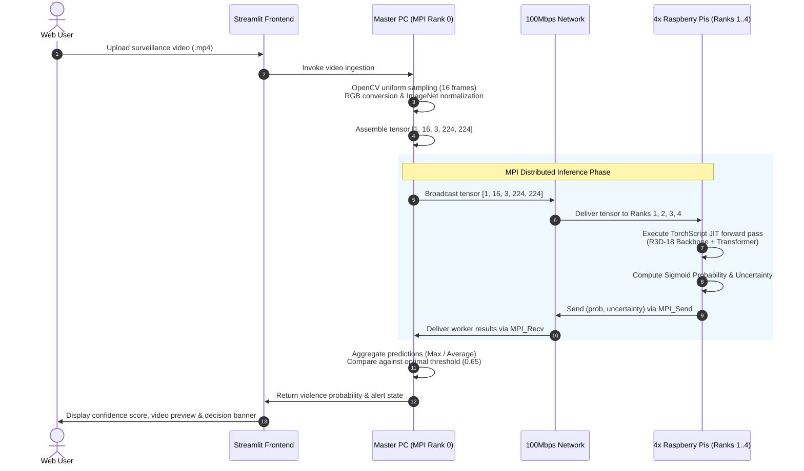

# System Architecture

This document describes the heterogeneous distributed architecture of the **Low-Cost HPC Cluster using MPI for Real-Time Violence Detection**, detailing the interaction between the physical hardware, networking fabric, MPI communication layer, deep learning pipeline, and user demonstration interface.

---

## 1. High-Level Architecture Overview

The system is designed as a **heterogeneous master-worker cluster** comprising a desktop workstation (Master PC) and four diskless **Raspberry Pi 4 Model B** single-board computers (Compute Nodes), interconnected via an Ethernet switch.

---

## 2. Hardware Specifications

| Component | Master Node (PC) | Worker Nodes (4x Raspberry Pi 4B) |
|---|---|---|
| **CPU** | x86_64 Multi-core Host Processor | Quad-core ARM Cortex-A72 (ARMv8) @ 1.5 GHz |
| **RAM** | 16 GB DDR4 | 4 GB / 8 GB LPDDR4-3200 per node (16–32 GB total) |
| **Storage** | NVMe SSD (Hosts golden root filesystems) | Diskless (Diskless PXE netboot over NFS) |
| **Network Interface** | Dual NICs (Uplink + Cluster interface) | Integrated Gigabit Ethernet (Broadcom BCM54213PE) |
| **Role** | Gateway, NFS/TFTP Server, MPI Master (Rank 0) | Dedicated MPI Compute Workers (Ranks 1–4) |
| **Operating System** | Ubuntu Linux / Debian x86_64 | Raspberry Pi OS (Debian 12 Bookworm, 64-bit) |

### Network Fabric
- **Switch**: TP-Link TL-SF1008D 8-Port Fast Ethernet Switch (100 Mbps).
- **Physical Cabling**: High-grade Category 6 (Cat6) UTP Ethernet cables.
- **Subnet Configuration**: Private subnet `192.168.50.0/24`.
  - Master Host: `192.168.50.1` (Gateway & DNS/DHCP server)
  - Worker 1: `192.168.50.101`
  - Worker 2: `192.168.50.102`
  - Worker 3: `192.168.50.103`
  - Worker 4: `192.168.50.104`

---

## 3. End-to-End Data Flow

The runtime data pipeline for distributed violence detection operates through five primary stages:

---

## 4. Key Architectural Decisions

1. **Diskless Architecture (PXE + NFS)**:
   - Eliminates micro-SD card wear and corruption across the cluster.
   - Centralizes maintenance: all OS updates, libraries, and model weights are updated once on the host's golden image (`/srv/nfs/mypi`).
2. **Heterogeneous Master-Worker Computing**:
   - Offloads video decoding, UI serving, and job coordination to the Master PC.
   - Dedicates all Raspberry Pi CPU cores to mathematical tensor inference.
3. **Preserving Full Temporal Sequences**:
   - Rather than fragmenting videos into micro-clips of 3–4 frames (which breaks long-range action dependencies), workers process full 16-frame sequences, allowing the Transformer temporal encoder to reason over the entire motion trajectory.
