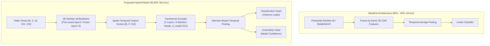

# Deep Learning Model Architecture & Training

This document details the video violence detection deep learning architecture, training methodology, hyperparameter configurations, and empirical evaluation metrics.

---

## 1. Problem Formulation & Dataset

The objective is binary video action recognition: classifying short video clips into either **Violence** ($y=1$) or **Non-Violence** ($y=0$).

### 1.1 Dataset Composition
The dataset combines three benchmark computer vision datasets:
1. **Real Life Violence Situations (RLVS)** Dataset.
2. **Hockey Fight** Dataset.
3. **Automated Video Violence Detection** Dataset.

### 1.2 Dataset Statistics
- **Total Samples**: ~7,000 video clips.
- **Video Formats**: `.mp4`, `.avi`.
- **Content Diversity**: Surveillance cameras, street fights, sports encounters, indoor domestic scenes, and normal human interactions (walking, sports, conversations).
- **Split Strategy**: Stratified 70% Training (~4,900 clips), 15% Validation (~1,050 clips), and 15% Testing (**1,050 clips**).

---

## 2. Model Evolution: From Baseline to Hybrid

### 2.1 Limitations of 2D Baseline Models
The initial baseline applied 2D CNNs (ResNet-18 and MobileNetV2) independently across frames, followed by temporal average pooling. While spatially strong, this approach discarded temporal motion order and velocity dynamics, plateauing at **80%–84%** validation accuracy.

### 2.2 Proposed Final Hybrid Model (`HybridVideoClassifier`)
The final architecture integrates spatio-temporal representations by combining:
1. **3D ResNet-18 (`r3d_18`) Backbone**:
   - Initialized with Kinetics-400 pretrained weights.
   - Layers 1 through 3 are frozen to retain generalized motion filters.
   - `layer4` (the final residual block) is unfrozen and fine-tuned for domain adaptation to violent physical interactions.
   - The original fully connected classification layer is replaced with `nn.Identity()`.
2. **Transformer Temporal Encoder**:
   - 3 Transformer encoder layers (`d_model=512`, `nhead=8`, `batch_first=True`).
   - Self-attention captures long-range temporal interactions and sudden acceleration patterns across the sequence.
3. **Dual Output Heads**:
   - **Classification Head**: Produces raw logits for the binary prediction.
   - **Uncertainty Head**: Estimates prediction confidence to flag ambiguous or low-certainty detections.

---

## 3. Training Strategy & Optimization

- **Loss Function**: Focal Loss combined with Label Smoothing ($\epsilon=0.1$) to prioritize hard edge-case physical collisions and mitigate overconfidence on borderline samples.
- **Optimizer**: Adam with initial learning rate $\eta = 3 \times 10^{-4}$.
- **Learning Rate Scheduler**: Cosine Annealing scheduler over training epochs.
- **Gradient Clipping**: Max gradient norm capped at $1.0$ to prevent gradient explosion during spatio-temporal backpropagation.
- **Data Augmentation Pipeline**:
  - MixUp regularization.
  - Uniform temporal jittering.
  - Playback speed variation ($0.8\times$ to $1.2\times$).
  - Random horizontal flipping and color jitter.

---

## 4. Decision Threshold Optimization

Rather than using a generic decision boundary ($0.5$), validation set threshold tuning was performed:

$$P(\text{Violence}) = \sigma(z) = \frac{1}{1 + e^{-z}}$$

$$\text{Decision} = \begin{cases} \text{Violence}, & \text{if } P(\text{Violence}) \ge \tau \\ \text{Non-Violence}, & \text{if } P(\text{Violence}) < \tau \end{cases}$$

- **Optimal Tuned Threshold**: $\tau = \mathbf{0.65}$.
- **Rationale**: Setting $\tau = 0.65$ maximizes precision (**97.25%**) while maintaining high recall (**93.75%**), drastically reducing false alarms in automated security surveillance scenarios.

---

## 5. Experimental Test Results

The model was evaluated on the independent test set of **1,050 samples**:

| Metric | Measured Value | Description |
|---|---|---|
| **Test Accuracy** | **95.55%** | Percentage of overall correct video classifications |
| **Precision** | **97.25%** | True violent events among all violent alarms |
| **Recall** | **93.75%** | Sensitivity in catching actual violent events |
| **F1-Score** | **95.47%** | Harmonic mean of Precision and Recall |
| **ROC-AUC** | **0.9746** | Area under the Receiver Operating Characteristic curve |
| **Optimal Threshold** | **0.65** | Operating threshold for decision boundaries |
| **Test Set Size** | **1,050 samples** | Dedicated holdout test set |
