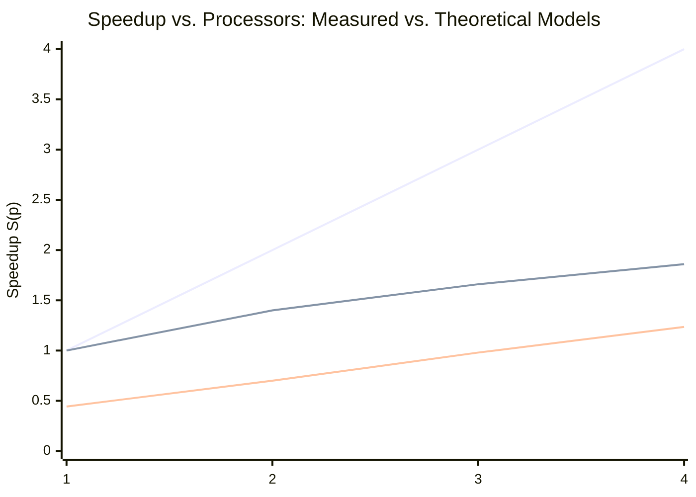

# HPC Cluster Performance Evaluation & Scalability Analysis

This document provides the complete empirical performance analysis of the heterogeneous Raspberry Pi 4 cluster, evaluating measured benchmarks against theoretical scaling models (**Amdahl's Law**, **Gustafson's Law**, and the **Karp-Flatt metric**) and exploring what-if scenarios for hardware upgrades.

---

## 1. Raw Benchmark Results

Benchmarks were executed using the distributed matrix multiplication workload ($N = 2000$, double precision, transferring **4,800 MB** across the network) across three configurations:
1. **Sequential Baseline**: Executed on the Master PC (single-threaded).
2. **1-Pi Worker (MPI)**: Single remote Raspberry Pi 4 node managed over OpenMPI.
3. **4-Pi Worker Cluster (MPI)**: Four remote Raspberry Pi 4 nodes computing in parallel over OpenMPI.

### Table 1: Measured Timing Results
| Configuration | Total Time (s) | Compute Time (s) | Comm. Overhead (s) | Measured Speedup $S(p)$ | Parallel Efficiency $E(p)$ |
|---|---|---|---|---|---|
| **Sequential (PC)** | **1042.7** | 1042.7 | 0.0 | $1.000\times$ | $100.0\%$ |
| **1 Pi Worker (MPI)** | **2354.3** | 2148.7 | 205.7 | $0.443\times$ | $44.3\%$ |
| **4 Pi Workers (MPI)** | **844.1** | 519.6 | 324.5 | **$1.235\times$** | **$30.9\%$** |

> [!NOTE]
> **Key Observation**: The 1-Pi MPI configuration is **$2.26\times$ slower** than the PC baseline due to the slower Cortex-A72 clock speed combined with MPI serialization latency. However, scaling to 4 Pis drops runtime to **844.1s**, yielding a net speedup of **$1.235\times$** over sequential.

---

## 2. Per-Worker Load Balance

Measuring individual computation times across all 4 Raspberry Pi nodes in parallel execution:

| Worker Node | Compute Time (s) | Deviation from Mean |
|---|---|---|
| **Pi Node 1** | 501.8 s | $-0.6\%$ |
| **Pi Node 2** | 502.2 s | $-0.5\%$ |
| **Pi Node 3** | 495.7 s | $-1.8\%$ |
| **Pi Node 4** | 519.6 s | $+2.9\%$ |
| **Mean** | 504.8 s | — |

- **Load Imbalance**: **2.9%** (measured as $(\text{Max} - \text{Mean}) / \text{Mean}$).
- **Insight**: Work distribution across the four nodes is remarkably uniform. The performance limitation is **not caused by algorithmic load skew**, but by network transport constraints.

---

## 3. Communication Bottleneck & Network Saturation

- **Total Payload Transferred**: $4,800 \text{ MB}$.
- **Network Hardware**: TP-Link TL-SF1008D Fast Ethernet switch ($100 \text{ Mbps} \approx 12.5 \text{ MB/s}$ maximum theoretical throughput).
- **Theoretical Wire Transfer Time**:
  $$T_{\text{theoretical}} = \frac{4800 \text{ MB}}{12.5 \text{ MB/s}} = 384.0 \text{ s}$$
- **Measured Communication Time**: **$324.5 \text{ s}$**.
- **Network Saturation Ratio**:
  $$\frac{324.5 \text{ s}}{384.0 \text{ s}} \approx 84.5\%$$
  The interconnect operates near physical wire capacity, confirming that the Fast Ethernet switch is the dominant cluster bottleneck.

---

## 4. Theoretical Scalability Models

*(Line 1: Linear Ideal $S=p$, Line 2: Amdahl Model $f_s=0.3845$, Line 3: Measured Cluster Performance)*

### 4.1 Amdahl's Law Analysis
Amdahl's Law states that program speedup is bounded by its serial portion ($f_s$):
$$S(p) = \frac{1}{f_s + \frac{f_p}{p}}, \quad \text{where } f_s + f_p = 1$$

For this cluster:
- Serial fraction $f_s = \frac{324.5}{844.1} = \mathbf{0.3845} \ (38.45\%)$
- Parallel fraction $f_p = 1 - 0.3845 = \mathbf{0.6155} \ (61.55\%)$
- Amdahl Predicted Speedup for $p=4$:
  $$S_{\text{Amdahl}}(4) = \frac{1}{0.3845 + \frac{0.6155}{4}} = \mathbf{1.857\times}$$
- Asymptotic Amdahl Ceiling ($p \to \infty$):
  $$S_{\max} = \frac{1}{f_s} = \frac{1}{0.3845} = \mathbf{2.601\times}$$

### 4.2 Karp-Flatt Metric (Experimental Serial Fraction)
The Karp-Flatt metric evaluates actual parallel overhead by estimating the effective serial fraction $e$ from empirical measurements:
$$e = \frac{\frac{1}{S(p)} - \frac{1}{p}}{1 - \frac{1}{p}}$$

Substituting $p = 4$ and measured $S(4) = 1.235$:
$$e = \frac{\frac{1}{1.235} - \frac{1}{4}}{1 - \frac{1}{4}} = \frac{0.8097 - 0.25}{0.75} = \frac{0.5597}{0.75} \approx \mathbf{0.746} \ (74.6\%)$$

> [!IMPORTANT]
> The system behaves as if **74.6%** of runtime is serialized. This large divergence from the theoretical serial fraction ($38.45\%$) captures the severe impact of physical network contention, bus contention, and Master serialization.

---

## 5. What-If Analysis: Proposed Gigabit Upgrade

> [!NOTE]
> The figures below represent **theoretical projections** based on upgrading the network fabric, not empirical measurements.

The existing setup connects Raspberry Pi 4 nodes (which feature native Gigabit Ethernet controllers) through a $100 \text{ Mbps}$ switch, utilizing less than $10\%$ of their network capability.

### Proposed Solution
Replace the TP-Link TL-SF1008D Fast Ethernet switch with a **TP-Link TL-SG108** ($1 \text{ Gbps}$ unmanaged 8-port switch, $\approx \$20 \text{ USD}$).

### Projected Performance Impact
- **New Communication Time** ($125 \text{ MB/s}$ throughput):
  $$T_{\text{comm, new}} = \frac{4800 \text{ MB}}{125 \text{ MB/s}} = \mathbf{38.4 \text{ s}} \quad (\text{vs. } 324.5 \text{ s, an } 8.5\times \text{ decrease})$$
- **Projected Total Runtime**:
  $$T_{\text{new}} = 519.6 \text{ s} + 38.4 \text{ s} = \mathbf{558.0 \text{ s}}$$
- **Projected Speedup**:
  $$S_{\text{new}}(4) = \frac{1042.7 \text{ s}}{558.0 \text{ s}} \approx \mathbf{1.87\times} \quad (+51\% \text{ gain over current } 1.235\times)$$
- **Projected Serial Fraction $f_s$**: Drops from $38.45\%$ to **$6.88\%$**.
- **Projected Amdahl Theoretical Ceiling**: Increases from $2.601\times$ to **$14.53\times$**.

### Comparison Table: Current vs. Projected Upgrade
| Metric | 100 Mbps Switch (Measured) | 1 Gbps Switch (Projected Upgrade) | Difference |
|---|---|---|---|
| **Communication Time** | 324.5 s | 38.4 s | $-88.2\%$ |
| **Total Runtime** | 844.1 s | 558.0 s | $-33.9\%$ |
| **Speedup $S(4)$** | **$1.235\times$** | **$1.870\times$** | **$+51.4\%$** |
| **Serial Fraction $f_s$** | 38.45% | 6.88% | $-31.57\%$ |
| **Amdahl Max Speedup $S_{\max}$** | $2.601\times$ | $14.53\times$ | $+458.6\%$ |
| **Parallel Efficiency $E(4)$** | 30.9% | 46.7% | $+15.8\%$ |
