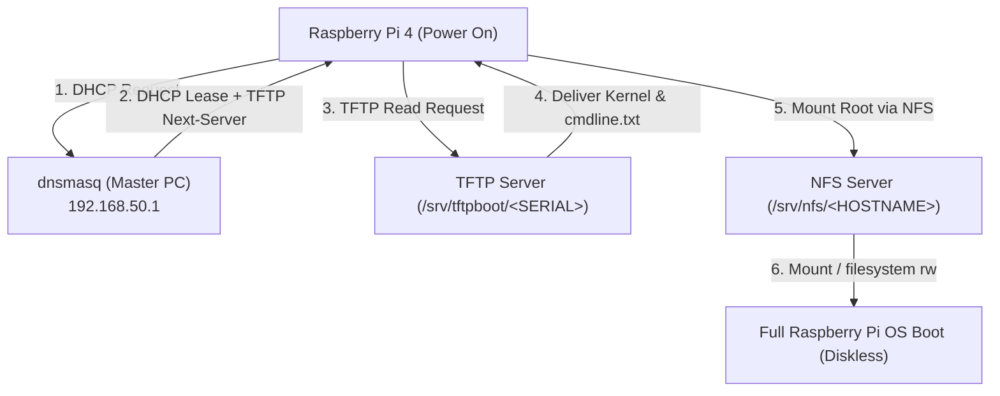

# Cluster Infrastructure & Network Booting

This document outlines the setup, network configuration, and diskless auto-provisioning infrastructure that powers the 5-node heterogeneous cluster.

---

## 1. Diskless Network Booting (PXE / NFS)

To eliminate the unreliability, slow I/O, and maintenance burden of physical micro-SD cards on four separate Raspberry Pi nodes, the cluster uses a **diskless network boot architecture**:



### 1.1 Step-by-Step Boot Sequence
1. **Power-On**: The Raspberry Pi EEPROM bootloader activates with `BOOT_ORDER=0xf41` (network boot priority enabled).
2. **DHCP Discovery**: The Pi broadcasts a DHCP request on `192.168.50.0/24`. `dnsmasq` responds with a fixed IP address and the TFTP boot server IP (`192.168.50.1`).
3. **TFTP Kernel Loading**: The Pi fetches the kernel (`kernel8.img`), device tree blobs (`bcm2711-rpi-4-b.dtb`), and kernel command line (`cmdline.txt`) from `/srv/tftpboot/<SERIAL>`.
4. **NFS Root Mount**: The Linux kernel initializes network drivers and mounts its root filesystem over NFSv3:
   ```text
   root=/dev/nfs nfsroot=192.168.50.1:/srv/nfs/slave1,vers=3 rw ip=dhcp rootwait
   ```
5. **System Startup**: `systemd` initializes from the host's exported directory.

### 1.2 Verifying Bootloader Configuration
On each Raspberry Pi, verify the EEPROM configuration:
```bash
vcgencmd bootloader_config
```
Expected configuration must include:
```text
BOOT_ORDER=0xf41
```

---

## 2. Server Configuration on Master Host

### 2.1 Dependencies Installation
Install network and filesystem daemons on the Master PC (Ubuntu / Debian):
```bash
sudo apt update && sudo apt install -y \
    nfs-kernel-server \
    dnsmasq \
    tftpd-hpa \
    kpartx \
    unzip \
    xz-utils \
    openmpi-bin \
    libopenmpi-dev
```

### 2.2 NFS Root Exports (`/etc/exports`)
Each compute node is mapped to a dedicated root directory:
```text
/srv/nfs/slave1 192.168.50.101(rw,sync,no_subtree_check,no_root_squash)
/srv/nfs/slave2 192.168.50.102(rw,sync,no_subtree_check,no_root_squash)
/srv/nfs/slave3 192.168.50.103(rw,sync,no_subtree_check,no_root_squash)
/srv/nfs/slave4 192.168.50.104(rw,sync,no_subtree_check,no_root_squash)
```

Apply exports without restarting the NFS service:
```bash
sudo exportfs -ra
```

### 2.3 DHCP + TFTP Configuration (`/etc/dnsmasq.conf`)
`dnsmasq` provides lightweight, unified DHCP and TFTP services:
```ini
# DHCP Configuration
interface=enx5c53102a71f8
dhcp-range=192.168.50.100,192.168.50.150,255.255.255.0,12h

# TFTP Server Configuration
enable-tftp
tftp-root=/srv/tftpboot
pxe-service=0,"Raspberry Pi Boot"

# Static IP Assignments (MAC -> IP -> Hostname)
dhcp-host=dc:a6:32:01:02:03,192.168.50.101,slave1
dhcp-host=dc:a6:32:01:02:04,192.168.50.102,slave2
dhcp-host=dc:a6:32:01:02:05,192.168.50.103,slave3
dhcp-host=dc:a6:32:01:02:06,192.168.50.104,slave4
```

---

## 3. Golden Image & Auto-Provisioning

To scale or restore nodes effortlessly, a **Golden Image** (`/srv/nfs/mypi`) serves as the template. Adding a new node requires executing [`scripts/provision_node.sh`](../scripts/provision_node.sh):

```bash
sudo ./scripts/provision_node.sh slave1 192.168.50.101 dc:a6:32:01:02:03 87654321
```

The script automatically:
1. Clones `/srv/nfs/mypi` to `/srv/nfs/<HOSTNAME>`.
2. Updates `/etc/hostname` inside the root tree.
3. Generates `/boot/cmdline.txt` with specific NFS parameters.
4. Bind-mounts `/srv/nfs/<HOSTNAME>/boot` into `/srv/tftpboot/<SERIAL>`.
5. Registers the static MAC lease in `dnsmasq.conf`.
6. Appends the export rule in `/etc/exports` and runs `exportfs -ra`.
7. Touches `/srv/nfs/<HOSTNAME>/boot/ssh` to enable the SSH daemon.

---

## 4. NAT Masquerading & Internet Gateway

The Master PC shares its internet uplink with the cluster using kernel IP forwarding and `iptables`:

```bash
# Enable IPv4 forwarding
sudo sysctl -w net.ipv4.ip_forward=1

# Configure NAT Masquerade on uplink interface
sudo iptables -t nat -A POSTROUTING -o enx022a010e1b03 -j MASQUERADE
sudo iptables -A FORWARD -i enx5c53102a71f8 -o enx022a010e1b03 -j ACCEPT
```
This is fully automated by [`scripts/setup_network.sh`](../scripts/setup_network.sh).

---

## 5. Passwordless SSH Authentication

OpenMPI relies on passwordless SSH to spawn remote `orted` runtime daemons.
- Key type: **Ed25519** (faster and significantly more compact than RSA-2048).
- Automated distribution: [`scripts/setup_ssh_keys.sh`](../scripts/setup_ssh_keys.sh).

### Handling Host Key Mismatch (MITM Warnings)
If a Pi node is re-provisioned, its host fingerprint changes. Clear stale keys:
```bash
ssh-keygen -f "$HOME/.ssh/known_hosts" -R "192.168.50.101"
```

---

## 6. Infrastructure Protocol Summary

| Protocol | Role | Software / Daemon | Config File |
|---|---|---|---|
| **DHCP** | Dynamic IP assignment at boot | `dnsmasq` | `/etc/dnsmasq.conf` |
| **TFTP** | Kernel & Device Tree delivery | `dnsmasq` | `/srv/tftpboot/<SERIAL>` |
| **PXE** | Netboot sequence trigger | Pi EEPROM Bootloader | `vcgencmd bootloader_config` |
| **NFSv3** | Network root filesystem mount | `nfs-kernel-server` | `/etc/exports` |
| **SSH** | Remote command & MPI runtime launch | `OpenSSH` (Ed25519) | `~/.ssh/authorized_keys` |
| **NAT** | Shared internet access | Linux Kernel `iptables` | `/etc/sysctl.conf` |
