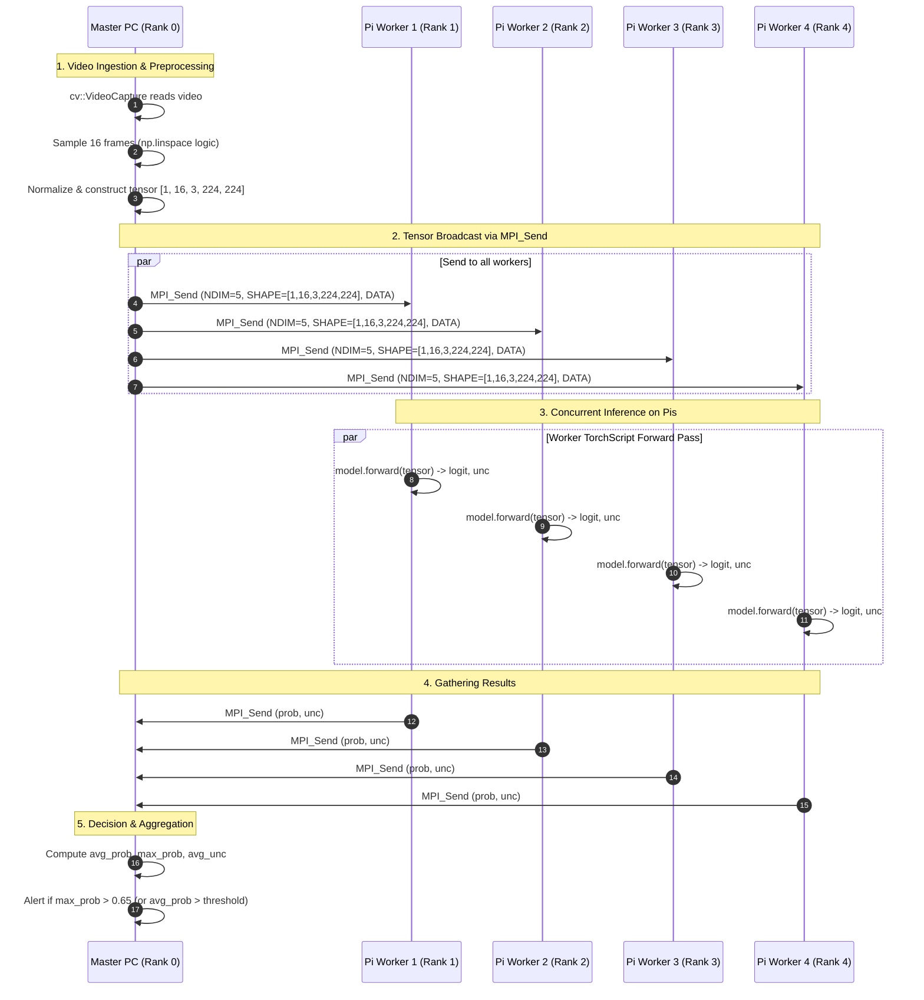

# MPI Distributed Processing Implementation

This document details the MPI-based distributed processing pipeline, explaining how the master and worker nodes coordinate, serialize PyTorch tensors across the network, execute model inference, and aggregate decisions.

---

## 1. Master-Worker Workflow

The distributed inference system follows a Master-Worker topology implemented in C++ using **OpenMPI 4.1.6**, **LibTorch (PyTorch C++ API)**, and **OpenCV**:



---

## 2. Why Send the Full 16-Frame Tensor to Every Pi?

A naive parallelization strategy might split a 16-frame video into 4 chunks of 4 frames each, dispatching one chunk per worker. However, as documented in Section 21 of the project report:

> **Crucial Engineering Insight:**  
> The deep learning model was trained on 16-frame spatio-temporal sequences. Slicing the clip into 4-frame sub-clips destroys the temporal relationships and velocity vectors learned by the 3D-CNN and Transformer, causing catastrophic accuracy degradation.  
> 
> Sending the full 16-frame clip to each Raspberry Pi allows each node to perform independent inference over the complete sequence. Aggregating probabilities across the workers reduces noise, provides consensus, and enables early-alert triggering if any worker detects violence above the threshold.

---

## 3. Custom MPI Tensor Serialization Protocol

Standard MPI primitives (`MPI_Send`, `MPI_Recv`) transfer raw contiguous memory buffers. To transfer dynamically sized PyTorch tensors across language and platform boundaries, we established a three-part message protocol:

| Tag | Tag Macro | Type | Description |
|---|---|---|---|
| `10` | `TAG_TENSOR_NDIM` | `MPI_INT` | Number of dimensions in the tensor (e.g., `5`) |
| `11` | `TAG_TENSOR_SHAPE` | `MPI_LONG` (array) | Tensor dimensions: `[1, 16, 3, 224, 224]` |
| `12` | `TAG_TENSOR_DATA` | `MPI_FLOAT` (array) | Raw contiguous float32 pixel buffer |
| `20` | `TAG_RESULT_PROB` | `MPI_FLOAT` | Worker violence probability score `[0.0, 1.0]` |
| `21` | `TAG_RESULT_UNC` | `MPI_FLOAT` | Worker model uncertainty score |
| `99` | `TAG_DONE` | `MPI_INT` | Cluster termination signal |

### C++ Tensor Send Implementation
```cpp
void mpi_send_tensor(const torch::Tensor& t, int dest) {
    auto ct  = t.contiguous();
    int ndim = ct.dim();
    MPI_Send(&ndim, 1, MPI_INT, dest, TAG_TENSOR_NDIM, MPI_COMM_WORLD);
    
    std::vector<long> shape(ndim);
    for (int i = 0; i < ndim; i++) shape[i] = ct.size(i);
    MPI_Send(shape.data(), ndim, MPI_LONG, dest, TAG_TENSOR_SHAPE, MPI_COMM_WORLD);
    
    int numel = static_cast<int>(ct.numel());
    MPI_Send(ct.data_ptr<float>(), numel, MPI_FLOAT, dest, TAG_TENSOR_DATA, MPI_COMM_WORLD);
}
```

---

## 4. Worker Execution Loop (TorchScript C++ API)

Workers operate in a non-blocking poll loop using `MPI_Iprobe`. When a tensor arrives, the worker deserializes the memory buffer and executes the JIT model:

```cpp
torch::Tensor input = mpi_recv_tensor(0);

float prob = 0.5f, unc = 0.5f;
try {
    torch::NoGradGuard no_grad;
    auto output = model.forward({input}).toTuple();
    float logit = output->elements()[0].toTensor().item<float>();
    unc         = output->elements()[1].toTensor().item<float>();
    prob        = 1.0f / (1.0f + std::exp(-logit));
} catch (const c10::Error& e) {
    std::cerr << "[Pi " << rank << "] Inference error: " << e.what() << "\n";
}

MPI_Send(&prob, 1, MPI_FLOAT, 0, TAG_RESULT_PROB, MPI_COMM_WORLD);
MPI_Send(&unc,  1, MPI_FLOAT, 0, TAG_RESULT_UNC,  MPI_COMM_WORLD);
```

---

## 5. Python `mpi4py` Alternative Implementation

In addition to the C++ LibTorch implementation, the repository provides [`mpi/distributed_inference.py`](../mpi/distributed_inference.py) using `mpi4py`.

This script supports chunk-based video distribution across MPI ranks using collective operations:
- `comm.bcast`: Broadcasts metadata and round counters.
- `comm.scatter`: Scatters video frame batches across workers.
- `comm.gather`: Collects binary predictions and confidence scores back to Rank 0.

---

## 6. Matrix Multiplication Benchmark Harness

To evaluate parallel speedup, network latency, and efficiency independent of PyTorch framework overhead, the cluster was benchmarked using [`mpi/matmul_benchmark.c`](../mpi/matmul_benchmark.c).
- Master scatters matrix rows across workers.
- Full matrix $B$ is broadcast using `MPI_Bcast`.
- Workers compute local matrix products.
- Master gathers rows and logs per-rank execution time.
